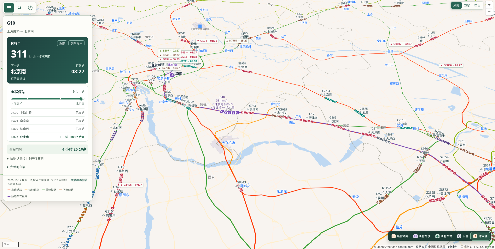

# 中国铁路实况

在地图上按北京时间回放铁路时刻表。点车站可以看下一批到发列车，点车次可以跟随它沿线路行驶，或拖动时间轴观察同一段铁路一天中的车流。位置和速度由时刻表及径路推演。



## 编译成纯静态网站

准备好运行快照后，在仓库根目录执行以下命令（Linux，Python 3.11 或以上）：

```sh
python3 tools/build_static.py --snapshot snapshot --output dist/site
```

也可以直接使用已导出的运行包，例如把 `--snapshot` 指向 `dist/current`。编译器检查当前快照的索引，预先生成车站、线路、班次、搜索与车序数据，并将页面、地图、当前版本时空片和署名文件复制进目标目录。`--jobs 4` 可降低同时编译的进程数。输出目录须是新目录，编译成功后才会出现在指定位置。

**把 `dist/site/` 的内容整体上传到支持目录首页的静态托管或 CDN 源站即可。** 可部署在域名根目录或子目录，例如 `https://example.org/rail/`。文件服务器按路径返回文件即可，无需运行 Python、Node.js、数据库、边缘函数或 API 路由。选择卫星模式时，浏览器会访问 EOX 的影像服务。

可以在本地预览同一份产物：

```sh
python3 -m http.server 8090 --bind 127.0.0.1 --directory dist/site
```

打开 <http://127.0.0.1:8090/>。静态站按需读取详情和时空片。列车运动、到发倒计时、日期筛选、索引排序和时钟播放都在浏览器中执行。

更新时建议把新站上传到独立版本目录，再切换入口；也可以在同一目录先上传数据文件，最后更新清单和网页。按内容散列命名的 `records/objects/` 和带版本号的时空片目录可长期缓存。`index.html`、`records/index.json`、`space-time/manifest.json` 及其他同名可变资源应允许重新验证。单次发布含大量小文件，请确认托管服务的文件数限额。用于公开 CDN 分发的数据与地图许可见[第三方说明](THIRD_PARTY.md)。

## 社区纠错和 GitHub Pages

提交可以审阅的[线路事实](inputs/line-facts.json)和[停站时刻修正](inputs/stop-times.json)。原始输入放在 `inputs/raw/` 时，GitHub Actions 会在 PR 和 `master` 的每次推送中从源数据重建地图和时空片。设置 **Settings → Pages → Source → GitHub Actions**后，`master` 构建通过即可发布。部署文件由 Actions 生成。

在 Linux 本地运行完整编译，需 Python 3.11+ 和 Node.js：

```sh
python3 tools/build_from_source.py --source /path/to/original-inputs
```

该命令读取原始输入，生成 `build/snapshot/` 和 `dist/site/`。使用 `--snapshot` 和 `--output` 可指定新的输出目录。原始文件清单与 PR 格式见[构建输入说明](inputs/README.md)。

如果原始资源还在 Git 之外，可将同一输入目录归档并在 GitHub 设置 `RAILLIVE_SNAPSHOT_URL` Secret 和 `RAILLIVE_SNAPSHOT_SHA256` Variable。这个地址需要指向**原始输入包**。此前的运行快照归档主要含生成索引，缺少本流程所需的原始文件。仓库和归档都缺输入时，Actions 只执行源码检查。

## Docker 运行

镜像包含 Python 服务、网页和地图渲染库。运行需要一份与代码兼容的独立快照，包含 `data/`、`map/` 和 `space-time/`。已有快照可按下节迁移。当前仓库没有提供整套数据的公共下载地址。仅有 GTFS 压缩包还需补齐底图、站线资料并构建索引。[快照维护说明](docs/snapshot.md)

将快照置于仓库根目录的 `snapshot/`，从仓库根目录执行：

```sh
docker build -t rails-offline .
docker run --rm -p 127.0.0.1:8080:8080 \
  --mount "type=bind,src=$(pwd)/snapshot,dst=/snapshot,readonly" rails-offline
```

打开 <http://127.0.0.1:8080/>。容器以 UID 65534 运行，需要对快照有读取和目录遍历权限。默认地图和空白底图可离线使用，选择卫星模式时会向影像服务请求瓦片。

## 迁移当前快照

在拥有完整工作快照的机器上，等数据构建结束后运行：

```sh
python3 tools/export_snapshot.py --source snapshot dist/current
```

目标须为新目录。将整个 `dist/current/` 复制到目标机并作为 `/snapshot` 挂载。导出包含当前生效版本、数据库、底图和署名说明；原始下载、采集缓存和历史时空片留在工作快照里。换数据版本时，可启动第二个容器在另一端口验收。

## 本地开发

在 Linux 上使用 Python 3.11 或以上版本。运行服务使用 Python 标准库。构建快照中的运动曲线另需 Node.js，浏览器验收另需 Chromium 和 Python 的 `websockets` 包。

```sh
python3 tools/prepare.py
python3 build/app/serve.py
```

默认监听 `127.0.0.1:8080`，可用 `RAILS_BIND`、`RAILS_PORT` 调整。修改源码后重新执行 `prepare.py` 并重启本地服务。`--snapshot /path/to/snapshot` 可指定另一份快照。启动时会检查所需文件以及索引和运动模型的指纹。

| 目录 | 用途 |
| --- | --- |
| `web/` | 页面、列车绘制、时间轴、时空片客户端及第三方渲染库 |
| `backend/` | HTTP API、站线资料、车序与区域查询 |
| `tools/snapshot/` | 时刻表导入、底图和时空片编译、数据审计 |
| `tests/snapshot/` | 快照回归与整日时空片对账 |
| `tests/browser/` | 浏览器交互回归及性能测量 |
| `snapshot/`、`build/`、`dist/` | 本地数据、组装后的运行目录、导出产物，均由 Git 忽略 |

已有工作快照并完成 `prepare.py` 后可运行：

```sh
python3 -m unittest discover -s tests/snapshot -p 'test_*.py'
python3 tests/snapshot/verify_space_tiles.py
```

静态发布前可从仓库根目录运行以下检查。前两项核对完整静态记录与时空片，最后一项通过专用 Chromium 在静态预览端口对比原快照查询结果并操作地图：

```sh
python3 tests/snapshot/verify_static_records.py dist/site
python3 tests/snapshot/verify_space_tiles.py dist/site/space-time
python3 tests/browser/check_static_site.py 8090
```

浏览器测试连接一个专用 Chromium 调试实例，例如以独立用户目录和 `--remote-debugging-port=19851` 启动 Chromium，再执行 `python3 tests/browser/check_train_camera_browser.py 8080`。环境变量 `RAILS_CDP_PORT` 可覆盖调试端口。[历史性能基准及复测方法](docs/space-time.md)

## 许可

原创代码采用 MIT 许可。随附地图库保留其原始许可。时刻表、铁路底图和卫星影像分别列有来源、署名及再分发条件。[MIT 许可](LICENSE) · [第三方软件与数据](THIRD_PARTY.md)
